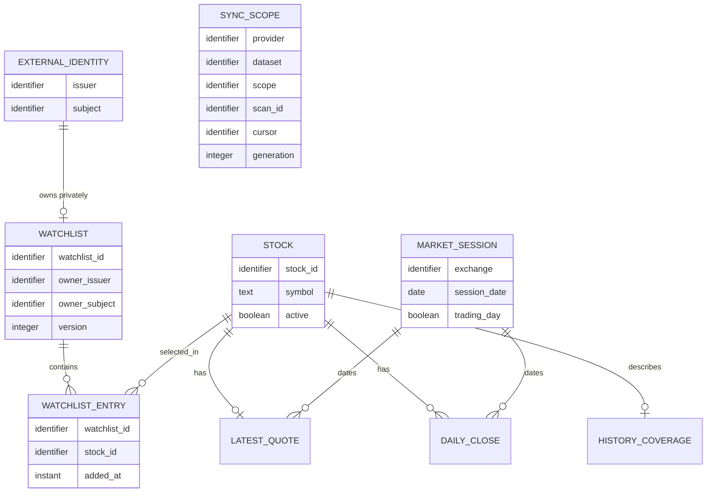

# Laboratory 5 — Model the Dashboard and Define Its API

**Student:** Oprea Alexandru · **Group:** InfA241 · **Language:** English  
**Product:** Personal Investment Dashboard

[Laboratory index](../README.md) · [Lab 4](../lab-4/README.md) · [Assignment](https://github.com/metreniuk/system-design-labs/blob/main/labs/05-domain-data-model/README.md) · [Lecture 6](https://github.com/metreniuk/system-design-labs/blob/main/lectures/lecture-06-api-design-and-data-modeling.md)

## 1. Scope and decisions carried forward

The API covers market overview, trending Stocks, combined exchange/sector filtering, name/symbol search, Stock reference details, latest accepted prices, daily History, and private Watchlist reads/additions/removals. Orders, Holdings, profit and loss, SSE, alerts, and public sharing are excluded. Supported instruments remain Nasdaq-listed common/ordinary equity and equity ADRs/ADSs in USD.

The authenticated User is an **external identity**, as explicitly required by Lab 5. Labs 3–4's opaque same-origin session cookie remains the browser mechanism, but session verification/expiry/revocation is abstracted behind the existing authentication boundary. Local session records are not part of this domain ER model, and no local User table, password model, or authentication endpoint is added. Every instance must receive the same verified issuer/subject pair. Authentication failure is never bypassed by a cache hit.

Lab 2's price policy, read-your-own-Watchlist-change rule, seven-year History, and ownership requirement remain in force. Lab 4's L1/Redis caches are server details, without client endpoints. This lab adds an explicit trending rank and paginated API projections; these are recorded refinements of the previous read classes, not new trading features or measured capacity claims.

## 2. Logical data model

Stored facts use **snake_case**; HTTP JSON uses **camelCase**. The following tables describe logical meanings and missing values, not physical SQL types, indexes, or database DDL. Required means a missing value prevents the record from being accepted. All example market values are synthetic.

### 2.1. ExternalIdentity (external reference, not a local table)

The existing authentication boundary verifies a session and supplies a stable identity. Identity is the pair (issuer, subject); no enrolment, password, local User table, or sign-in endpoint is introduced.

| Stored field | Meaning | Example | Missing-value rule |
| --- | --- | --- | --- |
| `issuer` | Trusted identity namespace | `https://identity.example` | Required; reject an untrusted issuer. |
| `subject` | Stable subject within that issuer | `subject-42` | Required; never accept it from a request body. |

### 2.2. Stock

One supported instrument listing with a stable stock_id. Ticker/name changes do not create a new identity; ticker reuse never reassigns an existing identity.

| Stored field | Meaning | Example | Missing-value rule |
| --- | --- | --- | --- |
| `stock_id` | Stable instrument identity | `stk_aapl` | Required; never recycled. |
| `symbol` | Current display ticker | `AAPL` | Required for an accepted reference record. |
| `name` | Display company/instrument name | `Apple Inc.` | Required. |
| `exchange` | Listing venue | `XNAS` | Required; v1 supports only XNAS. |
| `sector` | Normalised sector category | `technology` | Nullable if the provider cannot classify it; the filter token unknown selects null. |
| `currency` | Quote currency | `USD` | Required; unsupported currencies are excluded. |
| `instrument_type` | Eligible equity category | `common` | Required: common, ordinary, equity_adr, or equity_ads. |
| `active` | Eligible for discovery and new additions | `true` | Required boolean; no implicit default for unknown status. |
| `delisted_at` | Confirmed delisting instant | `2026-10-01T20:00:00Z` | Null for active/never-confirmed-delisted instruments; inactive status does not itself invent a delisting date. |
| `source_updated_at` | Time the accepted reference was updated | `2026-11-12T08:00:00Z` | Required; does not replace any provider observation time. |

### 2.3. LatestQuote

At most one latest accepted regular-session observation per Stock, keyed by stock_id. An absent row means no accepted quote, not price zero. A confirmed daily close is held by DailyClose.

| Stored field | Meaning | Example | Missing-value rule |
| --- | --- | --- | --- |
| `stock_id` | Owning Stock | `stk_aapl` | Required. |
| `session_date` | Regular session to which the observation belongs | `2026-11-12` | Required; references MarketSession for the Stock exchange. |
| `price` | Positive decimal monetary amount | `230.50` | Required and positive; reject invalid/missing observations instead of writing zero. |
| `provider_time` | Observation instant supplied by the provider | `2026-11-12T14:44:00Z` | Required timezone-aware timestamp; future/invalid observations are rejected. |
| `provider_revision` | Provider correction identifier if supplied | `rev-2` | Nullable when the provider has no revision; conflicting same-time values then cannot silently replace an accepted observation. |
| `accepted_at` | Commit/acceptance time in the Dashboard | `2026-11-12T14:59:00Z` | Required; independent of provider_time. |

### 2.4. DailyClose

One accepted unadjusted official close per (stock_id, session_date). Corrected values replace the same logical point after provider validation.

| Stored field | Meaning | Example | Missing-value rule |
| --- | --- | --- | --- |
| `stock_id` | Owning Stock | `stk_aapl` | Required. |
| `session_date` | Trading day of the close | `2026-11-11` | Required; references the market calendar. |
| `close` | Positive unadjusted daily close | `227.50` | Required; missing trading-day data is an absent point. |
| `provider_time` | Provider observation time of the close | `2026-11-11T21:00:00Z` | Required; keep the original source time. |
| `provider_revision` | Correction/version identifier | `close-rev-1` | Nullable under the same conflict policy as LatestQuote. |
| `accepted_at` | Time this version was accepted | `2026-11-11T21:16:00Z` | Required. |

### 2.5. MarketSession

Calendar day identified by (exchange, session_date), including holidays. This allows a known no-session day to differ from missing calendar information.

| Stored field | Meaning | Example | Missing-value rule |
| --- | --- | --- | --- |
| `exchange` | Venue using this calendar | `XNAS` | Required. |
| `session_date` | Date in America/New_York | `2026-11-12` | Required. |
| `trading_day` | Whether a regular session is scheduled | `true` | Required boolean; unknown is not false. |
| `opens_at` | Scheduled opening instant | `2026-11-12T14:30:00Z` | Required on a trading day; null on a known holiday/weekend. |
| `closes_at` | Scheduled closing instant, including early closes | `2026-11-12T21:00:00Z` | Required on a trading day; null otherwise. |
| `verified_at` | Time calendar information was verified | `2026-11-12T08:00:00Z` | Required; overdue verification prevents guessed closed-market exemptions. |

### 2.6. HistoryCoverage

One coverage record per Stock for its requested/backfilled daily-history horizon. It records successful scans, including intervals with zero observations; it does not assert that every trading day has a price.

| Stored field | Meaning | Example | Missing-value rule |
| --- | --- | --- | --- |
| `stock_id` | Owning Stock | `stk_aapl` | Required. |
| `from_date` | Earliest calendar date covered by the scan | `2019-11-12` | Required for an established coverage record. |
| `to_date` | Latest calendar date covered by the scan | `2026-11-11` | Required; not earlier than from_date. |
| `complete` | Whether the provider scan finished for this interval | `true` | Required; false or absent coverage cannot prove an empty result. |
| `missing_session_dates` | Known trading dates without an accepted close | `[]` | Required list; empty only when no known gaps, not when coverage is unknown. |
| `checked_at` | Time coverage was established/reconciled | `2026-11-12T08:00:00Z` | Required. |

### 2.7. Watchlist

One private list per verified external identity. The owner pair, rather than a public caller-supplied User ID, establishes ownership.

| Stored field | Meaning | Example | Missing-value rule |
| --- | --- | --- | --- |
| `watchlist_id` | Internal list identity | `wl_42` | Required; not a client selection input. |
| `owner_issuer` | Trusted owner namespace | `https://identity.example` | Required, obtained from authentication. |
| `owner_subject` | Trusted owner subject | `subject-42` | Required, obtained from authentication. |
| `version` | Monotonic committed membership version | `7` | Required; starts at 0 and increments on an actual membership change. |
| `created_at` | Time the list was created | `2026-11-01T10:00:00Z` | Required. |

### 2.8. WatchlistEntry

Association identified by (watchlist_id, stock_id). One Stock can appear in many Users’ lists, but only once in each list.

| Stored field | Meaning | Example | Missing-value rule |
| --- | --- | --- | --- |
| `watchlist_id` | Owning private Watchlist | `wl_42` | Required. |
| `stock_id` | Selected Stock, including retained inactive entries | `stk_aapl` | Required; preserve Stock reference while membership exists. |
| `added_at` | Time the current membership was committed | `2026-11-12T15:00:01Z` | Required; duplicate addition preserves this value. |

### 2.9. SyncScope

Durable collector state keyed by (provider, dataset, scope). The design uses one provider; dataset separates quotes, reference, calendar, and history work.

| Stored field | Meaning | Example | Missing-value rule |
| --- | --- | --- | --- |
| `provider` | Configured provider identity | `primary-market-feed` | Required. |
| `dataset` | Dataset being synchronised | `quotes` | Required: quotes, reference, calendar, or history. |
| `scope` | Bounded coverage partition | `XNAS:regular` | Required. |
| `scan_id` | Current scan identity | `scan-20261112-1459` | Null before any scan begins. |
| `cursor` | Provider continuation position | `provider-page-2` | Null before the first page or after a complete scan; interpret with complete. |
| `complete` | Whether the current scan finished | `false` | Required; false before the first completed scan. |
| `last_attempt_at` | Most recent outbound attempt | `2026-11-12T14:59:00Z` | Nullable before any attempt. |
| `last_success_at` | Most recent successful scope completion | `2026-11-12T14:58:30Z` | Nullable before any successful complete scan. |
| `retry_after` | Earliest permitted retry instant | `2026-11-12T15:00:00Z` | Nullable when no delay applies; provider Retry-After is honoured. |
| `lease_owner` | Current collector instance | `dashboard-2` | Nullable when unclaimed. |
| `lease_until` | Lease expiry instant | `2026-11-12T15:00:10Z` | Null exactly when no lease exists. |
| `generation` | Fencing generation for conditional commits | `12` | Required nonnegative counter; expired workers cannot commit with an older generation. |

### 2.10. Relationships and ownership



`EXTERNAL_IDENTITY` is a reference to the authentication system, not a persisted local User entity. An identity may not yet have a Watchlist; `GET /v1/watchlist` then represents it as an empty logical list with version 0. The first accepted addition creates the list if needed. Every entry belongs to one list and one Stock. A Stock may have zero accepted quote/coverage rows and many daily closes. Every quote/close has one known trading session; calendar rows can exist without observations. The exchange for each price record is obtained through Stock and must agree with the referenced session.

SyncScope is operational coordination rather than an owner of market entities: a scan can affect many records, and a record can be corrected in a later scan. Records and the scope cursor advance atomically with a matching lease generation. Sync credentials stay in server secret configuration, not in these records or the API.

Retain History within the rolling seven-year window. Retain inactive Stock references for at least seven years after delisting and longer while any Watchlist refers to them. The retained last quote of an inactive instrument is historical information, not a valid current price. Deleting membership never deletes market data; deleting or expiring market data never silently deletes membership.

### 2.11. Stored facts versus derived values

| API value | Derivation and missing rule |
| --- | --- |
| `stockId`, `instrumentType`, `providerTime`, `addedAt` | Map the corresponding snake_case stored facts to camelCase. |
| `ageSeconds` | Floor of response evaluation time minus provider_time; a future source time is invalid, not negative age. |
| `quote.status` | Evaluate provider age and known session boundaries at response time, never at Redis insertion time. |
| `changePercent` | `(accepted price − previous completed session close) / previous close × 100`, computed with decimal arithmetic and displayed to two decimals. Null if either required observation is missing or unacceptable. The example `(230.50 − 227.50) / 227.50 × 100` rounds to `1.32`. |
| Trending order | Among active eligible Stocks with an acceptable **current-session regular quote** and a positive previous-session close, sort descending by the absolute unrounded change percentage, then stock_id ascending. Both strong gains and losses can trend. This is price movement, not popularity or an investment recommendation. |
| `activeStockCount`, `pricedStockCount` | Count the complete accepted supported universe and policy-valid price representations at asOf. If reference coverage/calendar cannot establish the counts, return 503 rather than guessed zero. |
| `coverage` | Complete only when the range is known from successful coverage and all expected available trading-day observations are accounted for; known gaps produce partial. Unknown coverage is unavailable. |
| `nextCursor` | Opaque continuation position bound to the operation, filters, ordering, limit, and (for private reads) owner/version. Null means the end. |

Trending has no valid candidates outside a regular session, before the first delayed current-session quotes arrive, or when no eligible movement can be computed: return a known empty list with `200`. A failed source or unknown coverage is `503`, not an empty trending list. Since prices are unadjusted, corporate actions can produce large movements; the UI labels them unadjusted and does not claim total returns.

The price policy is unchanged: normal-session age up to 15 minutes gives `delayed_feed`; over 15 through 20 minutes gives `delayed`; over 20 minutes or invalid time gives unavailable. During closed periods use the last completed session's confirmed close (`market_closed`). The first 20 minutes after open allow a previous close labelled `awaiting_delayed_quote` until a current quote is available. The first 20 minutes after close allow an observation acceptable at close as `final_price_pending` until the official close arrives. At either grace boundary, stop using the fallback when its allowance ends. Unknown/overdue calendar prevents guessing. Inactive current-price requests return `409 stock_inactive`; retained History and Stock identity remain readable.

## 3. Client endpoint inventory

Illustrative base URL: `https://dashboard.example`. It is a documentation domain, not a deployed service. `/v1` appears once in every path. All operations require an authenticated session.

| Action | Method and versioned path | Inputs | Success | Access rule |
| --- | --- | --- | --- | --- |
| Market overview | `GET /v1/market/overview` | None | 200 Overview | Any verified User; public market facts only. |
| Discover, filter, search, trend | `GET /v1/stocks` | exchange, sector, q, sort, limit, cursor | 200 StockPage | Active supported Stocks; no private selections. |
| Stock reference detail | `GET /v1/stocks/{stockId}` | Stable Stock ID | 200 Stock | Includes retained inactive reference. |
| Latest accepted price | `GET /v1/stocks/{stockId}/price` | Stable Stock ID | 200 PriceResponse | Only a policy-valid quotation; otherwise an explicit error. |
| Daily History | `GET /v1/stocks/{stockId}/history` | fromDate, toDate, limit, cursor | 200 HistoryPage | Public, unadjusted daily closes; inactive retained History is allowed. |
| Read my private list | `GET /v1/watchlist` | limit, cursor | 200 WatchlistPage | Resolve owner from authentication on every page. |
| Add a Stock | `POST /v1/watchlist/items` | JSON `{ "stockId": "stk_aapl" }` | 201 newly committed membership + Location; 200 existing no-op | Current User's list only, session-bound CSRF check, active supported Stock. |
| Remove a Stock | `DELETE /v1/watchlist/items/{stockId}` | Stock ID, no body | 204 without body, including already absent | Current User's entry only; removal of inactive entries allowed; CSRF check. |

No `ownerId`, `userId`, `watchlistId`, `version`, `addedAt`, price, or server status is accepted in the addition body. `AddStock` is distinct from response models and forbids extra fields. Unknown/invalid body/query fields and malformed JSON produce `400`. Stock IDs match `^stk_[a-z0-9_]{1,48}$`; well-formed unknown IDs produce `404` on Stock/detail/History/price and on additions. Removal of an absent owned membership remains 204 without revealing whether anyone else follows that Stock.

### 3.1. Inputs, bounds, and defaults

| Input | Applies to | Default and validation |
| --- | --- | --- |
| `exchange` | Stock collection | Default XNAS; only XNAS is supported. Other values: 400. |
| `sector` | Stock collection | Omitted = all sectors; one of technology, financials, healthcare, industrials, consumer_discretionary, consumer_staples, energy, materials, real_estate, utilities, communication_services, unknown. Unknown selects unclassified records. |
| `q` | Stock collection | Omitted = no text restriction. When present, 1–80 characters and not whitespace-only. Trim, Unicode-casefold and match a substring of name or symbol; no client regular expressions. |
| `sort` | Stock collection | Default symbol: casefolded symbol ascending, stockId tie-breaker. Alternative trending uses the rank above. Apply combined filters **before** sorting and limiting. |
| `limit` | Stocks / Watchlist | Default 20, integer 1–100. Watchlist order is addedAt descending then stockId ascending. |
| `fromDate`, `toDate` | History | Both required; ISO dates, inclusive, fromDate ≤ toDate, no future date, within the rolling seven-calendar-year window at UTC request date. Leap-day cutoff maps to 28 February. |
| `limit` | History | Default 100, integer 1–200. Order sessionDate ascending; one point per date. Only 1d unadjusted history is offered, so no ambiguous resolution/basis parameters exist. |
| `cursor` | All three collections | Omitted for first page; otherwise 1–512 URL-safe characters. Opaque server token, not an authorisation credential. Malformed, expired, altered, query-mismatched or other-owner token: 400. |

Collection cursors are signed, carry a 60-second expiry, and bind the normalised arguments and last ordering tuple. Signatures and semantic cursor checks belong to the future business implementation; the submitted stubs only declare this contract and validate lexical shape. Public pages are **live**, not frozen snapshots: prices, rank and reference facts can change between requests. Clients deduplicate by stockId and restart discovery to refresh ranking. `asOf` is the evaluation time for that page, not a claim that all provider observations share one timestamp.

Watchlist cursors additionally bind the authoritative membership version. A changed version returns `400 cursor_expired`; restart at the first page, so a snapshot from before a confirmed change is never served as current. The owner is checked independently even with a valid cursor. Every newly started private read uses authoritative membership, across devices and service instances, preserving Lab 2's rule. Prices can be null while membership remains present.

History pagination is an API projection over Lab 4's canonical public full-range History result: server cache keys still include Stock, range, currency, daily resolution, and unadjusted basis. Apply page selection after obtaining valid canonical data. If a future implementation caches pages directly, limit and cursor/position must be part of its key. History correction visibility remains bounded by Lab 4's selected 307-second allowance. No User identity is inserted into public market cache values.

### 3.2. Success JSON examples

Amounts are decimal **strings** with currency, avoiding floating-point interpretation. Timestamps are RFC 3339 UTC strings. Nullable fields are included explicitly; null never means monetary zero. Examples below also appear in the source-generated OpenAPI document.

#### Market overview — 200

```json
{
  "exchange": "XNAS",
  "sessionDate": "2026-11-12",
  "marketStatus": "open",
  "activeStockCount": 3400,
  "pricedStockCount": 3380,
  "asOf": "2026-11-12T15:00:00Z"
}
```

Filtered page: `GET /v1/stocks?exchange=XNAS&sector=technology&q=app&sort=symbol&limit=1`. The example cursor represents another matching Stock; the exact token is illustrative and is not accepted by the stub.

#### Filtered Stock page — 200

```json
{
  "items": [
    {
      "stockId": "stk_aapl",
      "symbol": "AAPL",
      "name": "Apple Inc.",
      "exchange": "XNAS",
      "sector": "technology",
      "currency": "USD",
      "instrumentType": "common",
      "active": true,
      "quote": {
        "price": "230.50",
        "currency": "USD",
        "providerTime": "2026-11-12T14:44:00Z",
        "sessionDate": "2026-11-12",
        "status": "delayed",
        "ageSeconds": 960
      },
      "changePercent": "1.32"
    }
  ],
  "nextCursor": "c_page2_example",
  "asOf": "2026-11-12T15:00:00Z"
}
```

#### Valid filters with no matches — 200

```json
{
  "items": [],
  "nextCursor": null,
  "asOf": "2026-11-12T15:00:00Z"
}
```

#### Stock reference detail — 200

```json
{
  "stockId": "stk_aapl",
  "symbol": "AAPL",
  "name": "Apple Inc.",
  "exchange": "XNAS",
  "sector": "technology",
  "currency": "USD",
  "instrumentType": "common",
  "active": true
}
```

#### Accepted delayed price — 200

```json
{
  "stockId": "stk_aapl",
  "quote": {
    "price": "230.50",
    "currency": "USD",
    "providerTime": "2026-11-12T14:44:00Z",
    "sessionDate": "2026-11-12",
    "status": "delayed",
    "ageSeconds": 960
  },
  "asOf": "2026-11-12T15:00:00Z"
}
```

#### Daily History — 200

```json
{
  "stockId": "stk_aapl",
  "currency": "USD",
  "resolution": "1d",
  "basis": "unadjusted",
  "fromDate": "2026-11-10",
  "toDate": "2026-11-11",
  "points": [
    {
      "sessionDate": "2026-11-10",
      "close": "226.80",
      "providerTime": "2026-11-10T21:00:00Z"
    },
    {
      "sessionDate": "2026-11-11",
      "close": "227.50",
      "providerTime": "2026-11-11T21:00:00Z"
    }
  ],
  "coverage": "complete",
  "nextCursor": null,
  "asOf": "2026-11-12T15:00:00Z"
}
```

#### Known empty History range — 200

```json
{
  "stockId": "stk_aapl",
  "currency": "USD",
  "resolution": "1d",
  "basis": "unadjusted",
  "fromDate": "2026-11-07",
  "toDate": "2026-11-08",
  "points": [],
  "coverage": "complete",
  "nextCursor": null,
  "asOf": "2026-11-12T15:00:00Z"
}
```

#### Private Watchlist — 200

```json
{
  "items": [
    {
      "stock": {
        "stockId": "stk_aapl",
        "symbol": "AAPL",
        "name": "Apple Inc.",
        "exchange": "XNAS",
        "sector": "technology",
        "currency": "USD",
        "instrumentType": "common",
        "active": true
      },
      "addedAt": "2026-11-12T15:00:01Z",
      "quote": {
        "price": "230.50",
        "currency": "USD",
        "providerTime": "2026-11-12T14:44:00Z",
        "sessionDate": "2026-11-12",
        "status": "delayed",
        "ageSeconds": 960
      }
    }
  ],
  "nextCursor": null,
  "version": 7
}
```

#### Empty private Watchlist — 200

```json
{
  "items": [],
  "nextCursor": null,
  "version": 0
}
```

#### Addition input

```json
{
  "stockId": "stk_aapl"
}
```

#### Confirmed membership — 201, or 200 for an existing membership

```json
{
  "stockId": "stk_aapl",
  "addedAt": "2026-11-12T15:00:01Z",
  "version": 7
}
```

For a new membership, the response includes `Location: /v1/watchlist/items/stk_aapl`. A duplicate eligible addition preserves addedAt and does not increment version. An actual removal increments the private list version and returns **204 with no JSON body**. Confirm success only after durable commit. If the commit outcome is unknown, return 503 with `change_unconfirmed`; the client refreshes its authoritative list before deciding whether to repeat an action.

### 3.3. Error contract

Every error uses the same JSON envelope. Clients branch on `error.code`; the message is explanatory. Do not include credentials, a different owner's identifiers, stack traces, or private contents.

#### Invalid input — 400

```json
{
  "error": {
    "code": "invalid_input",
    "message": "limit must be between 1 and 100"
  }
}
```

| HTTP status | Typical codes and meaning |
| --- | --- |
| 400 | invalid_input, invalid_cursor, cursor_expired: malformed JSON, invalid parameter/body field, out-of-range dates/limit, or unusable continuation. FastAPI's default 422 is replaced by 400 in runtime and OpenAPI. |
| 401 | authentication_required / invalid_session: missing, expired, revoked or unverifiable session credentials. An unreachable authentication dependency is 503. |
| 403 | csrf_required / csrf_invalid: the authenticated caller cannot pass the session-bound mutation check. |
| 404 | not_found: no supported or retained Stock with that ID is visible. There are no endpoints for arbitrary private list owners. |
| 409 | stock_inactive: reference exists but current price or new addition is forbidden by activity state. |
| 429 | rate_limited: caller request budget exhausted; include Retry-After. |
| 500 | internal_error: unexpected failure, same envelope without implementation detail. |
| 503 | unavailable / change_unconfirmed: dependency/source/freshness/admission failure, or unconfirmed mutation. Include Retry-After when a useful delay is known. |
| 501 | not_implemented: **submitted contract-stub boundary**, not a simulated successful database operation. Replace these stubs when implementing the service. |

All operations declare shared 400/401/429/500/501/503 responses; relevant operations additionally declare 403/404/409. A fast error is not a successful data read. A collection can include null quotations while its own data is valid; standalone `/price` returns 503 if no policy-valid price exists. Unknown History coverage returns 503; known missing points produce partial coverage. No failed lookup becomes a fabricated empty list.

## 4. Shared API policies and server integrations

**Versioning:** `/v1` is the contract version location. Adding an optional response field such as `displayName` is compatible if clients tolerate unknown fields. Renaming stockId, changing monetary strings to numbers, changing a documented default/order, or removing a status value is breaking and requires a new version and migration period. Source package version 1.0.0 is distinct from the OpenAPI document-format version 3.1.

**Authentication:** same-origin HTTPS with `dashboard_session`, an opaque Secure/HttpOnly/SameSite cookie established by the pre-existing authentication boundary. The boundary validates issuer, subject, expiry and revocation. The API does not trust User IDs in URLs/bodies. Mutations require both that session and an `X-CSRF-Token` bound to it, plus an allowed Origin check in the eventual authentication adapter. OpenAPI represents cookie **AND** CSRF for mutations. There are no login/signup endpoints. Application responses use private/no-store HTTP cache policy; public L1/Redis storage remains internal and must never store the personalised Watchlist representation.

**Rate limits:** a proposed per-verified-identity budget is 10 read requests/s with a burst of 20, and 2 mutation requests/s with a burst of 4, enforced consistently across instances. These are selected operational assumptions, not extra capacity proven by Lab 4. A 429 includes Retry-After seconds. The client waits at least that long, adds jitter, and cancels obsolete UI reads; it never retries continuously. If absent, use exponential backoff starting at 1 second, capped at 30 seconds and three attempts. For ambiguous mutations, reconcile the owned Watchlist first; do not replay an old add after a later remove. General capacity overload remains 503, while a caller-specific quota breach is 429.

**Collector integration:** scheduled server calls use provider-specific HTTPS endpoints for reference, quotes, history, and calendar. They are not browser REST routes. The collector validates scope/identity, positive values, provider timestamps and revisions, then commits accepted data and SyncScope progress under the lease generation. It honours the shared provider quota, Retry-After, and Lab 3's retry policy. A provider timeout/429/invalid record preserves accepted data and original times. Browser cache misses read accepted storage, never the provider. No client endpoints for Redis, cache invalidation, or collector credentials are exposed.

## 5. Source-generated OpenAPI and inspection

- [api.py](./api.py): FastAPI routes, request/response schemas, validation, examples, errors, and security definitions. **All business handlers and identity/CSRF adapters are stubs.** A nonempty cookie is not treated as proof of identity; the adapter returns 501 until implemented.
- [requirements.txt](./requirements.txt): pinned Python dependency information.
- [generate_openapi.py](./generate_openapi.py): deterministic generator.
- [openapi.json](./openapi.json): generated contract, never manually edited.
- [check_contract.py](./check_contract.py): executable contract/schema/validation checks.
- [VIEWER-CHECK.md](./VIEWER-CHECK.md): observed Swagger UI inspection record.

Generation and validation, executed from this laboratory directory:

```sh
python -m pip install -r requirements.txt
python generate_openapi.py
python check_contract.py
```

The submitted source deliberately exposes no working database, provider, or authentication system. Unit checks override the identity dependency only within isolated tests to exercise input validation; they do not establish production ownership or capacity behaviour. Business success JSON is explicitly documented as an example. The generator removes the framework's unused 422 response, preserves explicit null example values, and expresses the required combined mutation security in source before writing the output.

## 6. Client flow: trending → Stock detail → add to Watchlist

Illustrative base URL: **https://dashboard.example**. The browser sends `Cookie: dashboard_session=<opaque-session>` on each request over HTTPS. The values below refer to the synthetic examples in section 3.2. The cookie and CSRF token are placeholders, not secrets or executable demo credentials.

| Order | Request | Expected response / example |
| --- | --- | --- |
| 1 | `GET /v1/stocks?sort=trending&limit=20` | 200 StockPage, ordered by absolute percentage movement. The selected item is stk_aapl with changePercent 1.32. Follow nextCursor with the same arguments if needed. |
| 2 | `GET /v1/stocks/stk_aapl` | 200 Stock reference example; show name, symbol, sector, exchange, currency, and active state. |
| 3 | `GET /v1/stocks/stk_aapl/price` | 200 PriceResponse example: USD 230.50, provider time 14:44, age 960 seconds, delayed label at 15:00 UTC. |
| 4 | `GET /v1/stocks/stk_aapl/history?fromDate=2026-11-10&toDate=2026-11-11&limit=100` | 200 HistoryPage example: two unadjusted daily closes, complete coverage and no next page. |
| 5 | `GET /v1/watchlist?limit=20` | 200 owned list, initially the emptyWatchlist example. If nonempty, follow pages to determine membership; do not infer absence from only the first page. |
| 6 | `POST /v1/watchlist/items` with Content-Type application/json, X-CSRF-Token and body `{"stockId":"stk_aapl"}` | 201 Membership and Location on a new durable addition; 200 on a confirmed duplicate. |
| 7 | `GET /v1/watchlist?limit=20` with no old cursor | 200 owned list including stk_aapl and version 7 in the example, or a later confirmed state. Fetch next pages if necessary. |

Calls 2–5 may run concurrently after selecting the Stock; the numbered order describes their logical purpose. Stock detail needs both the dedicated **price and History requests**; the reference endpoint alone does not supply them. A surrounding overview widget separately calls `GET /v1/market/overview`; it is not required for the stated trending-to-detail-to-Watchlist flow. Removal, outside this flow, uses DELETE on the same Stock membership URL and expects an empty 204 response.

```http
POST https://dashboard.example/v1/watchlist/items
Cookie: dashboard_session=<opaque-session>
X-CSRF-Token: <session-bound-token>
Content-Type: application/json

{"stockId":"stk_aapl"}
```

```http
HTTP/1.1 201 Created
Location: /v1/watchlist/items/stk_aapl
Content-Type: application/json

{"stockId":"stk_aapl","addedAt":"2026-11-12T15:00:01Z","version":7}
```

| UI state | Visible behaviour |
| --- | --- |
| Loading | Show a loading state per panel; disable the add button while its request is pending. No spinner is interpreted as confirmation. |
| Success | Render identity, delayed/source-time labels, and dated unadjusted History. Show Added only after 201/200, then refresh the owned list. |
| Empty | Show No trending Stocks currently available, No historical prices for this period, or Your Watchlist is empty for the corresponding valid 200. These are distinct from failures. |
| 400 / 404 / 409 | Explain invalid inputs/refresh an expired cursor; show Stock not found; or explain that an inactive Stock cannot be added. Its existing membership remains removable. |
| 401 / 403 | Request session renewal through the existing authentication boundary, or explain that the change was rejected; do not claim that the list changed. |
| 429 | Honour Retry-After and retry only within the bounded policy. |
| 503 / timeout | Mark the affected price/history panel unavailable; never substitute zero or an empty list. For change_unconfirmed, show Change could not be confirmed and reconcile authoritative membership. |
| 501 in the submitted source | Display Contract stub — operation not implemented. This is expected for source-only definitions and is never presented as a completed live request. |

**Conclusion:** the logical model separates accepted market facts, derived price/ranking values, external identity, and owned membership. Eight versioned operations cover the requested scope. Their schemas and examples are generated from source, validated, and inspected in an OpenAPI viewer, while the client flow preserves freshness and confirmed-write semantics.
