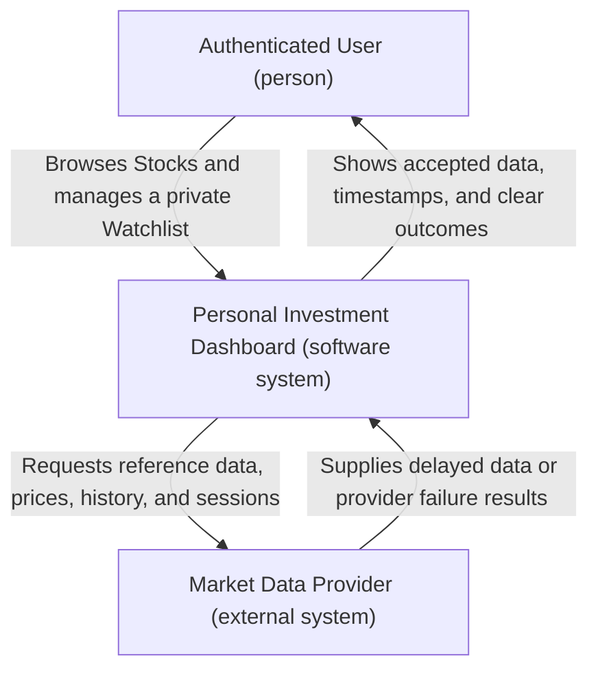
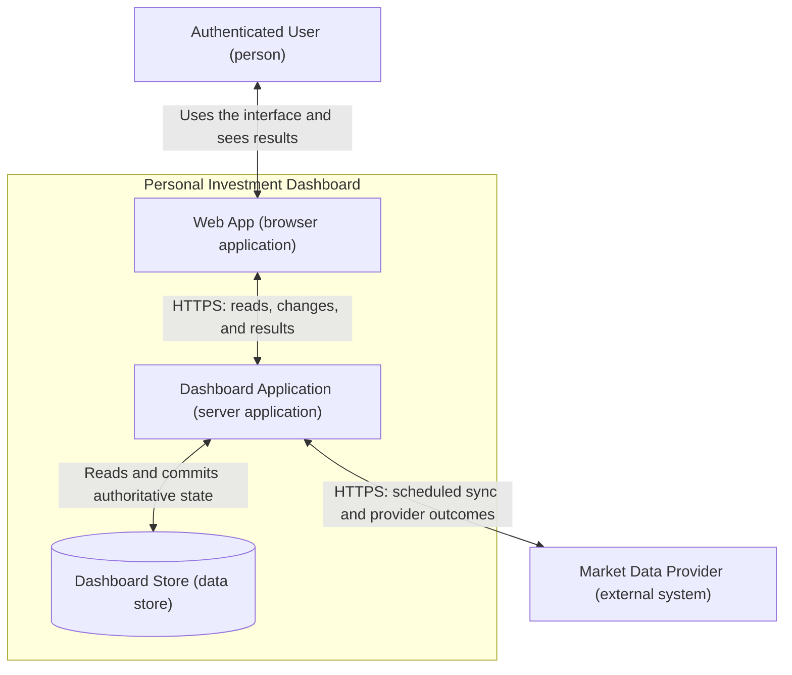
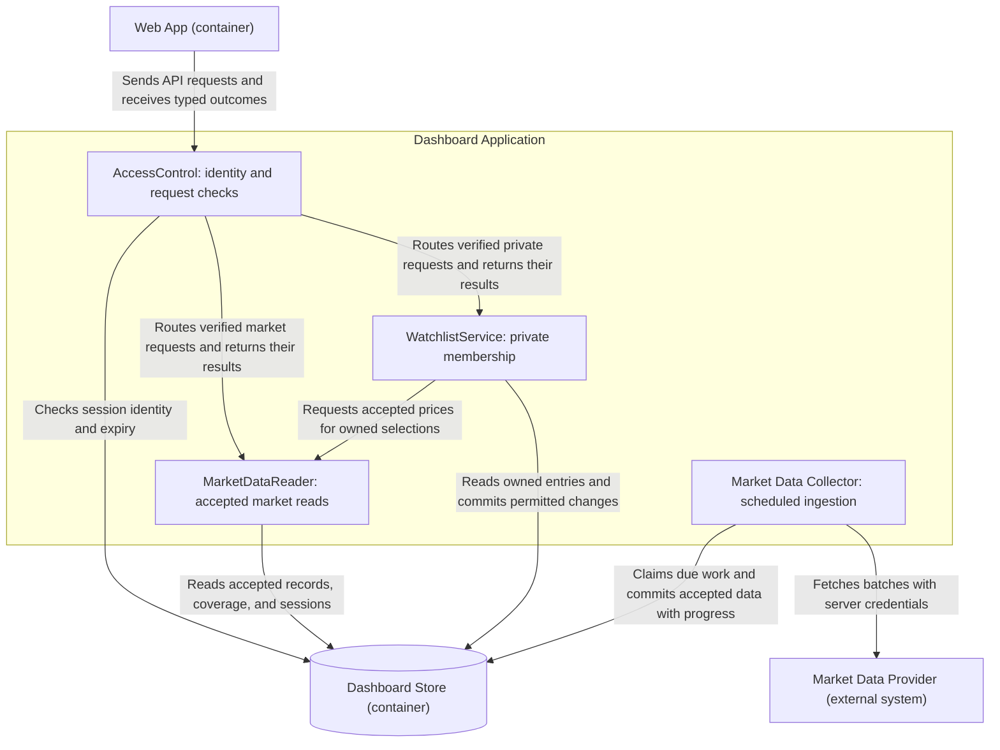
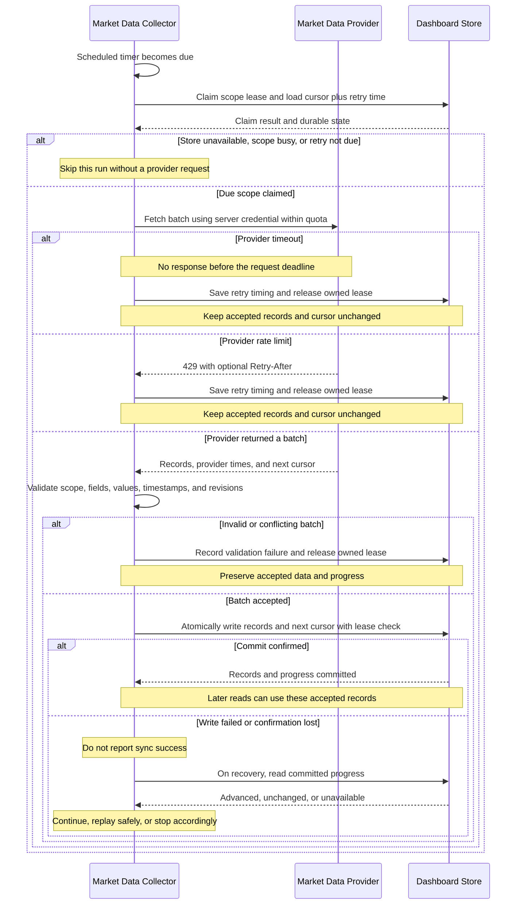
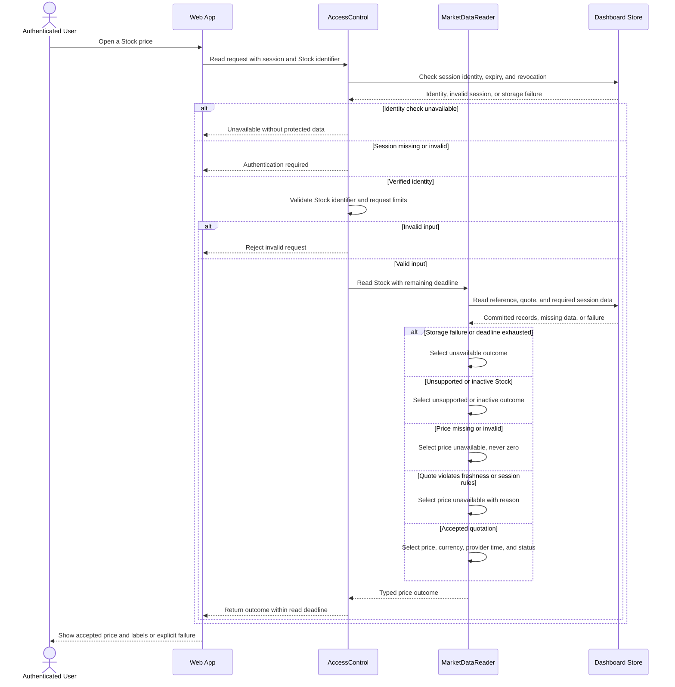
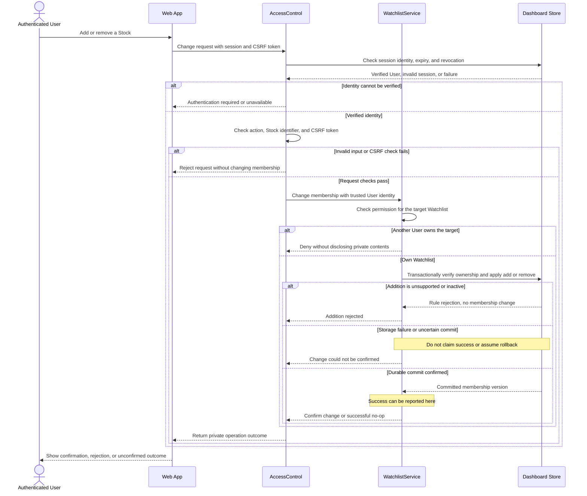

# Laboratory 3 — Draw the Dashboard Boundary

**Student:** Oprea Alexandru · **Group:** InfA241 · **Language:** English  
**Product:** Personal Investment Dashboard

[Laboratory index](../README.md) · [Lab 1](../lab-1/README.md) · [Lab 2](../lab-2/README.md) · [Assignment](https://github.com/metreniuk/system-design-labs/blob/main/labs/03-baseline-architecture/README.md) · [Lecture 4](https://github.com/metreniuk/system-design-labs/blob/main/lectures/lecture-04-architecture-decomposition-and-data-flows.md)

## 1. Design inputs and baseline decisions

The Dashboard retains Lab 1's authenticated User, single Market Data Provider, and five stories: market overview, search, exchange/sector filtering, Stock detail with history, and a private Watchlist. Version 1 covers supported Nasdaq-listed common/ordinary equity and equity ADRs/ADSs in USD. Trading, portfolio accounting, alerts, and public Watchlist sharing remain outside scope.

| Input from Lab 2 | Architectural consequence |
| --- | --- |
| Steady load: 79.2 / 792 / 7,920 RPS at 300 / 3,000 / 30,000 concurrent Users | Serve all six reads from shared accepted data; do not fetch from the provider for every User request. |
| Market-open capacity targets: 103 / 1,030 / 10,296 RPS, including the 10% margin | Keep the read path short and bound background ingestion work so it cannot consume all request-processing capacity. |
| Stock price p50 ≤ 100 ms and p95 ≤ 500 ms; each read class p95 ≤ 2 seconds; hard read deadline of 2 seconds | Include identity checks, storage, processing, and response transmission in the deadline. A failed dependency returns unavailable rather than waiting indefinitely. |
| Expected provider delay of 15 minutes; normal-session maximum accepted age of 20 minutes | Preserve provider timestamps and apply freshness rules when reading. A successful fetch does not reset the observation's age. |
| The same User's next read must reflect a confirmed Watchlist change or a later confirmed change | Confirm only after a durable commit; read private state from the authoritative committed store. |
| Zero successful cross-user Watchlist reads or writes | Derive identity on the server and enforce ownership on every private operation. |
| Initial raw market data: 769,878,384 B; 3,400 active Stocks; seven years of daily closes | One logical store is a reasonable baseline. Size and throughput still require validation together; raw bytes exclude indexes, sessions, Watchlists, and operational metadata. |
| Availability: 99.99% during market sessions and 99.9% outside them | Separate provider failure from User reads, retain accepted data, and measure each availability window. A single unprotected application process or database instance would remain a failure risk. |

**Selected approach:** a browser Web App, a server-side Dashboard Application, and a Dashboard Store. The Market Data Collector is a background component inside the Dashboard Application. A separate collector deployment, gateway, message broker, or cache is not needed to express the baseline responsibilities. Splitting those parts later requires evidence of contention or a separate operational need.

The collector runs scheduled synchronisation only. This deliberately selects the background-only alternative discussed in Lecture 4: a missing or expired price produces an unavailable result while the next permitted sync works independently. User requests never start, join, or wait for a provider call. This protects the two-second read boundary, at the cost of waiting for scheduled recovery when data is missing.

## 2. System Context diagram

The single system box is the Dashboard boundary. The User and provider are external; internal applications and storage are hidden.

Authentication is a prerequisite, and an expired session is a failure state of the same User. No external identity provider or additional market-data source is introduced. The provider does not receive a User's Watchlist.

## 3. Container diagram

| Container | Single primary responsibility | Boundary and decisions |
| --- | --- | --- |
| Web App | Present the Dashboard and collect User actions | Runs in the browser. Displays server-supplied data/status and never interprets an error as an empty market, zero price, or successful write. It cannot access the store or provider directly. |
| Dashboard Application | Enforce Dashboard behaviour | Serves the UI assets and API, validates identity and permissions, coordinates reads and Watchlist changes, and runs scheduled ingestion. Its components share one application boundary. |
| Dashboard Store | Retain authoritative Dashboard state | Holds accepted market data, private Watchlists, local session records, and sync coordination/progress. Requires atomic transactions, uniqueness constraints, and reads that observe committed Watchlist state. |

These are logical runtime containers, not a claim of one physical machine each. Application instance count, storage failover, and recovery arrangements must be established against Lab 2's load and availability targets. Any storage failover must preserve acknowledged Watchlist changes and sync progress; serving stale private state as current is not an acceptable recovery shortcut.

### Stored state and access boundaries

| State | Owner in the application | Essential rule |
| --- | --- | --- |
| Stock reference, latest quotes, daily history, session calendar | Market Data Collector writes; MarketDataReader reads | Save validated data. History is unique per Stock and session date. Preserve the seven-year history window and the 2,923-date calendar allowance from Lab 2. |
| Watchlist membership | WatchlistService | Unique `(user_id, stock_id)` membership; every read/change is scoped to the verified User. Keep inactive reference records while any Watchlist uses them, even beyond seven years. |
| Sessions | AccessControl | Resolve a protected, opaque session token to a User and expiry; fail closed when identity cannot be checked. Store a token digest, not the browser's raw bearer token. |
| Sync state | Market Data Collector | Durable scope/scan identifier, cursor, last attempt/success, retry time, active lease and generation. Records and progress advance together. |

The baseline uses a same-origin secure session cookie: `Secure`, `HttpOnly`, and `SameSite`, with server expiry/revocation checks and a CSRF check for changes. The browser never supplies a trusted `user_id`; a resource identifier is not proof of ownership. Sign-in enrolment is outside these authenticated flows. If local passwords are later introduced, only salted password hashes belong in account storage.

Provider credentials are injected into server-side runtime secret configuration and used only by the collector. They are absent from the repository, Web App bundle, URLs, User responses, and logs. Rotation changes server configuration; it does not require exposing a replacement credential to the User. Provider credentials and User session tokens are separate credentials with separate purposes.

## 4. Component diagram — Dashboard Application

Only the Dashboard Application is opened. The Web App, Dashboard Store, and Market Data Provider remain outside this component boundary.

| Component | Responsibility and Lab 1 coverage |
| --- | --- |
| AccessControl | API entry checks: resolve identity, validate request shape and permitted operation, enforce CSRF for writes, apply the read deadline, and pass a trusted identity. Resource ownership remains a WatchlistService responsibility. |
| MarketDataReader | DASH-1/2/3/4: Overview, Search, Filter, Stock price, and History. Apply supported-instrument, date-range, currency, calendar, and freshness rules. Distinguish valid empty results from missing/unavailable data. Supply the same accepted-price policy to WatchlistService. |
| WatchlistService | DASH-5: authorise private reads/changes, enforce uniqueness and add/remove rules, and return the same User's committed state. Combine owned membership with MarketDataReader results; missing prices never delete selections. |
| Market Data Collector | Run due work, enforce provider quota/retry timing, fetch and validate batches, and commit accepted records with durable progress. Scheduling, validation, and provider communication are responsibilities within this component, not additional deployed services. |

The collector and reader communicate through committed storage. A User read has no direct dependency on a running sync or a provider response. A collector failure can still affect reads later when accepted data expires.

## 5. Sequence A — Synchronise market data

**Starting assumptions:** the Dashboard Application is running, the provider's quota and pagination contract are configured, and runtime credentials are available only to the collector. The diagram follows one batch attempt of a scheduled scope. Subsequent permitted attempts must reclaim the scope after its saved retry delay.

### Scheduling, validation, and recovery rules

| Concern | Baseline decision |
| --- | --- |
| Due work | Refresh latest quotes every 60 seconds during regular sessions and the first 20 minutes after close. Synchronise reference data/calendar daily and session changes every 60 seconds during market activity. Backfill seven years of history at initialisation, then collect daily closes and reconcile corrections daily. |
| Overlap | Atomically claim a durable lease per provider/dataset/coverage scope. Renew it while working. A generation check prevents an expired worker from committing after a replacement takes over. Independent scopes share one provider quota budget; history backfill must leave capacity for latest-price and session work. |
| Provider failures | Select a five-second provider-request timeout and at most three transient attempts per scheduled refresh cycle, subject to quota. After that budget, wait for a later due cycle. Persist exponential backoff with jitter, capped at 60 seconds before any longer provider-imposed delay. Never retry before `Retry-After`; every scheduled trigger honours the same saved delay. Invalid credentials or invalid batches stop automatic retries for that scope until corrected. |
| Batch acceptance | Validate schema, stable Stock identity, supported exchange/type/currency, positive finite prices when present, expected session/date, timestamp validity, and bounded record sizes. A missing quote remains missing, never zero. Unknown sector is explicit. Unsupported records cannot enter the active supported universe; a valid delisting update may update an existing instrument. Reject the whole affected batch on malformed required data and report the reason. |
| Ordering and duplicates | Update a latest quote only if its provider observation is newer, with the comparison inside the write. An identical observation is a no-op. Conflicting values at the same time require an explicit provider correction/revision; otherwise reject the conflict. History has one point per Stock/session date, with validated corrections replacing that point. |
| Publication point | Commit accepted records and the next cursor atomically, conditional on the expected starting cursor and lease generation. No User reads an uncommitted batch or a raw provider response. Earlier committed batches can remain visible; an unfinished scan is not represented as complete coverage. |
| Uncertain commit | Read authoritative progress after recovery. If advanced, continue; if unchanged, replay using the same duplicate/ordering rules; if unreadable, stop. A new scan has its own identity. An expired provider cursor requires a supported restart, not a guessed skip. |
| Preserving old data | Failed sync leaves earlier accepted observations intact and does not change their provider timestamps. Prices remain readable only while Lab 2's freshness/session rules permit them. No complete reference refresh means no inference that omitted instruments were delisted. |

A run records its attempt time, validation outcome, saved progress, and completion time separately from the provider's observation times. Failure to persist coordination state stops new outbound work until the state can be read safely. A one-minute polling interval and up to one minute of processing retain Lab 2's normal freshness budget of `15 + 1 + 1 = 17 minutes`; long scans, quota shortages, and failures can break that assumption and must be visible.

## 6. Sequence B — Read a Stock price

**Starting assumptions:** the User may have a valid or expired session. The normal path requests a supported active Stock; the diagram also handles an invalid identifier and unsupported/inactive instruments. The within-Dashboard two-second deadline begins when the complete request arrives and includes the session lookup. All nested operations use the remaining budget. If a response cannot complete by the deadline, the attempt is a timeout, not a successful data read.

The read uses **only stored, accepted data**. It never contacts the Market Data Provider, even when the quote is missing or too old. An identity-storage failure also fails closed; it cannot bypass authentication merely because prices are shared market data.

| Price condition | Result shown to the User |
| --- | --- |
| Normal session, valid current-session observation, age ≤ 15 minutes | Price and provider time, with the delayed-feed status. |
| Normal session, 15 minutes < age ≤ 20 minutes | Price with a prominent Delayed label, provider time, and age. |
| Age > 20 minutes, future/missing timestamp, invalid price, or unavailable required session state | Price unavailable; never relabel fetch time as provider time or substitute zero. |
| Market closed after the closing grace period | Most recent completed session's confirmed close, dated and labelled Market closed. An older session's close cannot stand in for it. |
| First 20 minutes after open | Until an accepted current-session quote arrives, allow the previous confirmed close labelled Market open — awaiting delayed quote. After that grace, apply the normal-session rule. |
| First 20 minutes after close | Allow a quote that was acceptable at close, labelled Market closed — final price pending, until that session's confirmed close arrives. After the grace, require the close or return unavailable. |

The Web App re-evaluates the displayed age/status using the supplied provider time and session boundaries; a displayed quotation must not remain apparently acceptable after its limit expires. A fresh response cannot make an old observation fresh. Inactive instruments retain labelled historical information only. Missing required data remains distinct from a legitimate empty Search result or empty Watchlist.

## 7. Sequence C — Change a private Watchlist

**Starting assumptions:** each User has one private Watchlist. The server resolves the session to an internal User ID; any supplied target belongs to that ID or is rejected. The diagram covers add/remove, not trading. Market data may be stale without preventing removal of an owned entry.

Ownership and membership changes are enforced within the transaction, using the verified User ID as part of every private key/query. An addition verifies that the Stock is supported and active at the transaction's ordering point. Removal is allowed for inactive entries and is a successful no-op if the entry is already absent. Adding an existing eligible entry does not create a duplicate. Input or permission rejection never exposes another User's selections.

**Confirmation and next read:** after durable commit confirmation, a Watchlist read started by the same User must include the change or a later confirmed change, including from another session/device. It reads authoritative committed membership, with the same ownership check, before MarketDataReader supplies prices. It must not use a lagging private-state copy. If correct membership cannot be read, the result is unavailable. An unavailable quotation changes that entry's price status, not its membership.

**Unknown outcome:** a storage timeout or lost response may occur after a commit. The Web App shows Change could not be confirmed and refreshes authoritative membership once access returns. It does not report rollback or blindly replay an old command after a newer conflicting action. A deliberate repeated add/remove is safe when no intervening contrary action occurred; simultaneous changes are ordered by committed transactions. Lab 2 specifies read throughput, so no unsupported write-RPS target is inferred.

## 8. Capacity and failure review

| Pressure or failure | Design response | Evidence needed to validate the baseline |
| --- | --- | --- |
| 6,000 Stock price RPS within 7,920 steady RPS at the largest scale | Short authenticated storage path; shared accepted prices; lookup by stable Stock ID. | Per-class p50/p95/p99, session-check time, store latency, and deadline failures. A small data set does not itself prove 6,000 RPS capacity. |
| 10,296 RPS opening capacity target | Replay the six-read mix with the additional Overview/Watchlist flows; bound ingestion concurrency and batch size. | Acceptable completed RPS, backlog, CPU/storage contention, and response sizes at all three Lab 2 scales. Test the ten-second event and the selected 60-second sustained peak. |
| History responses contain up to 1,764 planned daily points per Stock | Validate requested date ranges and read ordered points; preserve missing-data distinctions and unadjusted-price labels. | Long-range History latency, result bytes, and interference with price reads. |
| Provider timeout, rate limit, invalid batch, or invalid credentials | Keep prior accepted data; delay or stop sync; preserve provider age and cursor. | Retry timing, quota use, invalid-batch rate, scan duration, and time until accepted quotes expire. |
| Application restart or collector overlap | Durable progress, leases, generation checks, and atomic records/progress publication. | Restart after commit but before acknowledgement; attempt a stale-worker write; verify no duplicated history or backward progress. |
| Private storage failure or cross-user request | Fail closed, reject unauthorized access, and confirm writes only after commit. | Two-User/two-session checks, immediate read after confirmation, ambiguous commit recovery, and zero successful ownership violations. |
| Application/store outage | Required flows become unavailable; a working browser shell does not count as uptime. Provider isolation cannot protect against failure of the shared store. | Per-window downtime and recovery drills. Lab 2's illustrative budgets remain 51.48 seconds during market hours and 2,077.2 seconds otherwise. |

The initial raw reference/quote/calendar data totals `870,400 + 707,200 + 607,984 = 2,185,584 B`; seven-year History contributes `767,692,800 B`. The shared market-data total remains `769,878,384 B`, independent of User count. Physical sizing additionally needs indexes, transaction overhead, session/Watchlist populations, sync metadata, backups, and any replication; those inputs are not supplied by the read model.

**Conclusion:** the baseline assigns every Lab 1 flow to an application component, separates scheduled provider ingestion from User reads, and ties visible success to validated data or a committed private change. The six diagrams define normal, rejected, and failed outcomes. Lab 2's latency, throughput, freshness, and availability figures remain design targets to validate, rather than measured properties of these diagrams.
