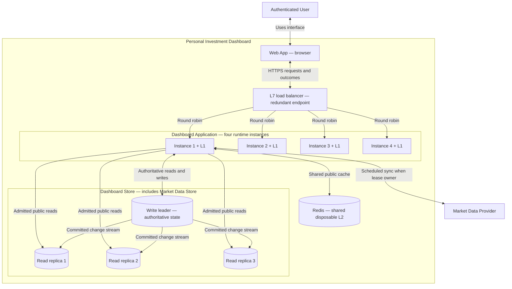
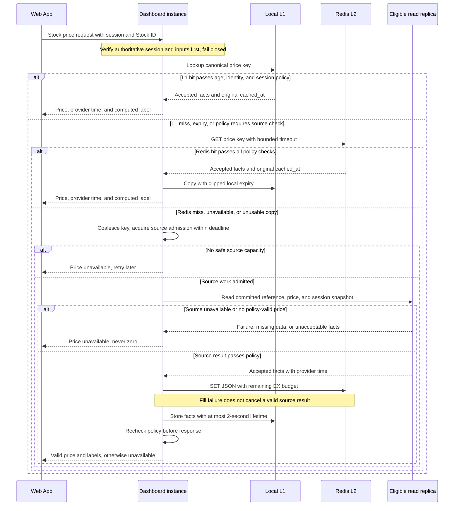
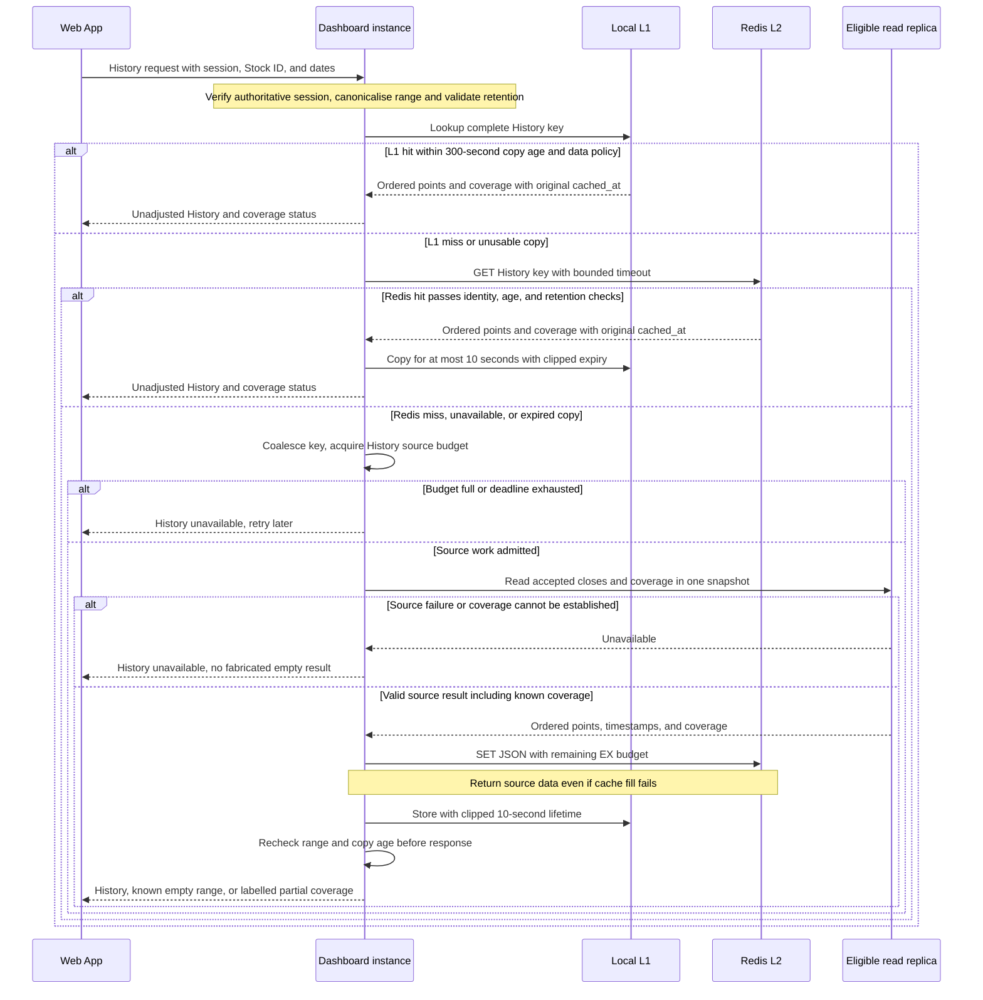

# Laboratory 4 — Scale the Dashboard Read Path

**Student:** Oprea Alexandru · **Group:** InfA241 · **Language:** English  
**Product:** Personal Investment Dashboard

[Laboratory index](../README.md) · [Lab 2](../lab-2/README.md) · [Lab 3](../lab-3/README.md) · [Assignment](https://github.com/metreniuk/system-design-labs/blob/main/labs/04-read-heavy-request-path/README.md) · [Lecture 5](https://github.com/metreniuk/system-design-labs/blob/main/lectures/lecture-05-horizontal-scaling-caching-and-availability.md)

## 1. Inputs, scope, and changes from the baseline

The product still has one authenticated User actor and one external Market Data Provider. The supported universe is Nasdaq-listed common/ordinary equity and eligible equity ADRs/ADSs in USD. Overview, Search, Filter, Stock price, History, and private Watchlist remain the six reads. Trading and public Watchlist sharing are outside scope.

| Earlier decision | Treatment in this laboratory |
| --- | --- |
| Lab 2: 600 Stock price RPS for 3,000 concurrent Users | Apply Lab 4's **20% buffer** to this read class: **720 RPS**. This replaces neither Lab 2's 10% margin for its six-read opening workload nor its 1,030 RPS aggregate target. |
| Stock price p50 ≤ 100 ms and p95 ≤ 500 ms; each read class p95 ≤ 2 seconds; hard deadline 2 seconds | Retained. Authentication, load-balancer waiting, cache access, source access, and response construction all consume the request budget. |
| Normal-session quote age ≤ 15 minutes, or up to 20 minutes with a prominent Delayed label | Retained on every cache and source response. Provider time is never replaced by cache time. Opening/closing exceptions remain those of Lab 2. |
| Confirmed Watchlist changes visible to subsequent reads; zero cross-user disclosure | Retained. Membership and session checks use authoritative storage, never these public caches or a lagging read replica. |
| Lab 3: Web App, Dashboard Application, Dashboard Store; background collector inside the application | Add an L7 load balancer, four application instances, L1 caches, shared Redis, and database replicas. Keep the same application components and external boundary. |
| One logical Dashboard Store holds market data and private state | Retain one logical store. Its market-data role is the assignment's **Market Data Store**. Show the write leader and three read replicas explicitly. |
| Lab 2 availability: 99.99% in market sessions and 99.9% otherwise | Retained as targets. Capacity arithmetic and Redis command execution do not demonstrate these availability levels. |

All capacities supplied by the assignment are teaching assumptions. The numeric guarantees below concern **Stock price reads**, without assuming any L1 or Redis hits. The full six-read workload still requires representative performance testing; a History query or authentication check cannot automatically be counted as a 250-RPS Stock price operation.

## 2. Dashboard capacity, routing, and state

### 2.1 Smallest ready instance count

```text
Buffered Stock price target = 600 × 1.20 = 720 RPS
Safe capacity of one Dashboard instance = 250 Stock price RPS
Without failure: ceil(720 / 250) = 3 ready instances
With one instance lost: (N − 1) × 250 ≥ 720
N ≥ ceil(720 / 250) + 1 = 4 ready instances

Four running: 4 × 250 = 1,000 RPS; 720 / 4 = 180 RPS per instance
After one loss: 3 × 250 = 750 RPS; 720 / 3 = 240 RPS per instance
Three initially, then one loss: 2 × 250 = 500 RPS — insufficient
```

**Decision: maintain at least four ready Dashboard instances before the peak.** A starting or unhealthy process does not count. Spread them across independent hosts; the arithmetic covers loss of one instance, not loss of several instances on the same host or zone.

Use the resource settings tied to the supplied load test in Lecture 5: CPU request **500m**, CPU limit **1 CPU**, memory request **512 MiB**, and memory limit **1 GiB** per instance. Changing resources requires repeating the measurement. If Kubernetes HPA is used, set `minReplicas: 4`; its CPU signal does not replace the RPS test. At a 60% target, the baseline is 60% of the 500m request, or 300m, not 60% of the CPU limit. Provision before market open because autoscaling and readiness take time.

The post-failure 30-RPS difference between 750 and 720 is price-read headroom, not proof that the remaining five read classes fit. Reserve measured resource budgets for ingestion and other reads, then increase the starting pool if the combined Lab 2 workload needs it. Do not lower Lab 2's targets to make four instances appear sufficient.

### 2.2 Load-balancer choice

**L7 HTTP load balancing with round robin among ready instances.** Stock price requests have similar service cost, so distributing requests in turn is a simple fit. L7 makes the decision per HTTP request even when the browser reuses a connection, and can distinguish read endpoints from Watchlist changes. TLS terminates at the balancer and encrypted connections continue to the application.

The main limit is that equal request counts do not imply equal CPU or database work: a long History read can cost more than a price lookup. Observe per-class latency, active requests, and saturation; use bounded endpoint concurrency and scale from measurements. Client-IP hashing is unnecessary because sessions are shared and many Users can share one IP.

- Readiness removes a starting, stopping, or locally overloaded instance from new routing. Drain active requests during planned stops. Liveness detects a stuck process; Redis failure alone must not trigger restart loops or make every application instance unready.
- A crash can interrupt an in-flight read. A bounded retry may use another ready instance only within the original deadline and admission budget. Do not automatically replay an unconfirmed Watchlist write.
- Use a redundant load-balancer deployment with one logical endpoint. The drawing represents this logical role; a lone proxy would remain a single failure point. Failure detection and rerouting are not instantaneous and their failed requests count in availability measurements.
- Keep a 2,000-ms end-to-end server deadline, including balancer queuing. Cache connection/read attempts have a selected 20-ms timeout and a circuit breaker; no retry loop may exhaust the price p95 budget. These budgets require validation, not merely configuration.

### 2.3 Required and disposable state

| State | Location | Result when a Dashboard instance stops |
| --- | --- | --- |
| Accepted prices and provider times, Stock reference, daily closes, calendar | Durable Dashboard Store | Another instance can read the same committed data. |
| Private Watchlist membership, uniqueness, ownership, committed version | Authoritative store leader | A subsequent authorised read observes the confirmed change or returns unavailable. |
| Session token digests, expiry, revocation | Authoritative store leader | Another instance verifies the session; no sticky routing is required. |
| Collector cursor, lease generation, retry time, accepted-batch progress | Durable store, transactionally updated | A replacement resumes safely; it cannot repeat or skip work by guessing. |
| Provider credential | Protected server runtime configuration | Replacement instances receive it securely; it is absent from public caches and browser responses. |
| Parsed requests, current identity result, local coalescing map, L1 entries | Bounded process memory | May disappear. An in-flight attempt can fail; later reads rebuild temporary state. |
| Redis entries | Disposable shared L2 cache | Can disappear independently; durable records remain the source of truth. |

Each application still contains the Market Data Collector. The existing durable lease and generation check allow only one owner per ingestion scope. Four application instances therefore do **not** create four independent provider polling loops or four quota allowances. User reads never contact the provider.

## 3. Market Data Store scaling and updated Container View

### 3.1 Read-replica calculation

The write leader is reserved for accepted-data writes, session checks, private Watchlist operations, and other reads requiring its latest committed value. It contributes **zero** routine public-price capacity.

```text
Safe read capacity per eligible replica = 400 Stock price RPS
Minimum read replicas for 720 RPS = ceil(720 / 400) = 2
Two replicas: 800 RPS; after one replica fails: 400 RPS

Selected deployment: 1 write leader + 3 read replicas
All three eligible: 1,200 public Stock price RPS
One replica lost or too far behind: 2 × 400 = 800 RPS ≥ 720 RPS
```

Three read replicas are an explicit extra resilience choice; two are the minimum for normal operation and for a failure confined to an application instance. The selected three also tolerate the loss of one **read replica** for the price workload. They do not establish write-leader failover or capacity for arbitrary additional queries.

Each replica starts from a consistent snapshot and then applies the leader's ordered committed changes. A selected maximum **5-second replay lag**, monitored through a regularly advancing replication heartbeat/checkpoint, determines eligibility. An idle database must not be mistaken for a lagging replica just because no business write occurred. A disconnected, unknown-lag, or over-limit replica is removed from the read pool. Price freshness is checked independently using provider time; being within the lag limit never makes an old quote valid.

Public queries use a consistent read snapshot containing the required reference, quote/history, and session metadata. Route ordinary price/history reads across eligible replicas. Keep session validation and strict private reads on the leader. Never redirect all public misses to the leader after replica loss. With only one eligible replica, at most 400 price source reads/s are available; excess misses receive explicit unavailability.

The leader uses durable commits. Read replication may be asynchronous, so automatic promotion of an arbitrary follower could lose acknowledged private changes. This design **does not promote an unverified follower**: during leader loss, authentication and private operations fail closed until the authoritative leader recovers, or a separately verified failover can preserve every acknowledged commit. Backups and recovery are still required. This is a remaining availability limitation, not a claim that three read replicas achieve four nines.

### 3.2 Container View



Dependency arrows are shown from Instance 1 to keep the view readable; Instances 2–4 have the same Redis, leader, replica, and provider connections. Only the instance holding the durable scope lease performs that scope’s provider sync. Every instance runs the same AccessControl, MarketDataReader, WatchlistService, and collector components from Lab 3. The three read copies are instances of the same logical database. Browser access to Redis, the database, or provider credentials is prohibited.

## 4. Shared cache rules

Both cases use **cache-aside with simple TTL**, L1 first and Redis second. There is **no stale-while-revalidate window**: an expired cache copy is not served after a failed refresh. This cache-age rule is separate from Lab 2's permission to display an age-labelled delayed provider quote.

1. Authenticate against authoritative session state and validate the request **before** looking up public data. “Public cache” means the result is identical across authorised Users, not that anonymous access is enabled.
2. Canonicalise inputs and use a versioned key. No User ID, token, Watchlist membership, selected-private-list ordering, or ownership result belongs in either value.
3. Preserve the original `cached_at` when copying Redis to L1. Set local expiry to the earliest of its short lifetime, the original cache expiry, and any price/session deadline. A hit never extends lifetime. Reject malformed or future timestamps; use synchronised UTC clocks and monotonic local TTL timers.
4. Check data identity, schema, cache age, and applicable product policy again immediately before returning. The browser recomputes price age and session labels so a displayed value cannot remain apparently valid after its deadline.
5. A miss, eviction, malformed entry, or Redis timeout follows bounded source fallback. Only a successful, validated source result fills caches. A source error is never stored as an empty array, zero price, or valid missing symbol.
6. If Redis fill fails after a valid source read, return that valid source result and keep a bounded L1 copy. Redis is optional for correctness. A malformed entry may be evicted; an unsupported instrument is a typed outcome, not a fabricated value.

Initial cache memory budgets are selected assumptions: **32 MiB per L1** and **256 MiB for Redis**, with eviction of disposable entries. Bound price entries to 8 KiB and History entries to 256 KiB; a larger valid result may bypass caching. Use a Redis eviction policy suitable for disposable data, such as `allkeys-lru`. Do not infer actual memory consumption from JSON bytes alone; measure overhead and working-set hit rates.

## 5. Cache case A — Stock price

### 5.1 Contract

Repeated requests for one Stock otherwise repeat the same reference/quote/session snapshot read, deserialisation, and market-price assembly. L1 removes Redis work; L2 removes repeated database reads across instances. Authentication and time-dependent validation still run.

| Decision | Stock price contract |
| --- | --- |
| Key | `price:v1:{stock_id}:XNAS:USD:regular`. Example: `price:v1:stk_aapl:XNAS:USD:regular`. `stock_id` is a stable internal ID, not a ticker that can later be reused. Exchange, currency, regular-session mode, and schema version are explicit. |
| Value | Accepted price, stable ID, display symbol, exchange, currency, quote kind, `provider_time`, source update time, session identity/bounds, calendar verification time, and `cached_at`. Cache raw facts, not a permanently fixed “fresh” label. |
| Source | Committed Stock reference, accepted quote/confirmed close, and calendar/session records in an eligible Market Data Store read replica. Rebuilding never calls the provider. |
| L1 lifetime | At most **2 seconds**, clipped to the remaining Redis-copy age budget and product/session deadline. Eviction can occur sooner. |
| Fresh cache window | `0 ≤ now − cached_at < 15 seconds`. Redis uses `EX 15` for an immediate fill. Slow fills use the whole-second remaining budget; if none remains, skip caching. |
| Stale and expiry | Cache stale window **0 seconds**; age ≥ 15 seconds is a miss. Even a 1-second-old copy is unusable if its provider time/session fails the product rule. |
| Price freshness | Normal session: age ≤ 15 minutes shows the delayed-feed status; 15–20 minutes shows prominent **Delayed** plus provider time/age; age > 20 minutes is **Price unavailable**. Missing/future time, invalid price, or unavailable required session state also fails. |
| Failures | L1 missing → Redis; Redis missing/down → admitted replica read. Replica unavailable, invalid source result, full fallback capacity, or exhausted deadline → **Price unavailable — try again**. A still-usable cache hit may serve while public replicas fail, provided authentication succeeds. |

The cache has one canonical public price representation. Optional future currency conversion, extended-hours modes, or different price types would require distinct keys and a revised contract. UI language is applied after lookup; translated/private presentation is not cached in this key.

**Session boundaries are not a TTL exemption.** Re-evaluate the cached facts against the known Nasdaq calendar on every hit:

- While closed, require the most recently completed session's confirmed close, with its date and **Market closed**.
- During the first 20 minutes after open, the previous close is a labelled fallback only until an acceptable current-session quote is available. Before returning an old-close fallback, perform an admitted source read for a current quote; if that check cannot complete, return unavailable. This prevents a cache hit from hiding the first accepted quote already visible in the source. At the grace deadline, the previous-close fallback is forbidden.
- During the first 20 minutes after close, a quotation that was acceptable at close may be shown as **Market closed — final price pending**, until the confirmed close is available. Check the source before using this fallback as well. After the grace, require that session's confirmed close.
- Treat a required calendar whose daily verification is overdue as unavailable; cache expiry alone cannot confirm a trading session. A cached fallback is never allowed to survive a boundary merely because Redis has positive TTL.

These boundary fallbacks are less cache-efficient by design. They protect the product's transition rules. Any newly committed value can take up to the selected replica-lag bound to become visible on a public read; a stricter immediate latest-value check uses a separately admitted leader read or returns unavailable, never unlimited leader fallback.

### 5.2 Cache-read sequence



“Passes policy” includes the mandatory source check for a transition fallback; neither cache-hit branch bypasses it. Current quotes/confirmed closes that pass the policy can use the ordinary hit paths without that additional read.

## 6. Cache case B — Public daily History

### 6.1 Contract

History requests repeat range selection, sorting, and JSON construction over the same daily closes. The cache contains only public historical observations; a User's portfolio, trades, or Watchlist never changes this result.

| Decision | History contract |
| --- | --- |
| Key | `history:v1:{stock_id}:XNAS:USD:1d:unadjusted:{from_date}:{to_date}`. Inclusive, normalised ISO dates and the stable Stock ID determine the result. Example: `history:v1:stk_aapl:XNAS:USD:1d:unadjusted:2026-10-27:2026-10-28`. |
| Value | Identity, currency, exchange, inclusive range, daily resolution, unadjusted basis, ordered points with session date/close/provider time, coverage status, source update time, and `cached_at`. No pagination is used: cap the range at the seven-year product limit. |
| Source | Accepted daily closes and coverage metadata, joined with retained Stock reference and session calendar, in an eligible read replica. Use an index on `(stock_id, session_date)`. |
| L1 lifetime | At most **10 seconds**, never beyond the original cache-expiry time. |
| Fresh cache window | `0 ≤ now − cached_at < 300 seconds`. Immediate Redis fill uses `EX 300`; slow fills use the remaining budget. |
| Stale and expiry | Stale window **0 seconds**; cache age ≥ 300 seconds requires a source read. No expired History is served after refresh failure. |
| Source-data policy | Points must be accepted regular-session closes within the rolling seven-year retention limit. Old observation dates are expected, not evidence that History is invalid. A selected correction-visibility allowance is at most **307 seconds** after an accepted correction: up to 5 seconds of eligible replica lag, up to 2 seconds to finish an admitted source request, and 300 seconds of cache age. |
| Failures and empty results | Cache failure → bounded source fallback. Failed source/unknown coverage → **History unavailable**. A known empty range with complete coverage → **No historical prices for this period**. Known partial coverage → show available points with **Incomplete history**; never invent missing closes. |

The 307-second correction allowance is an explicit new design assumption for History, which had no numeric correction-propagation SLA in Lab 2. It is not permission to return unaccepted values. Recheck the rolling retention boundary when serving an entry, even before its TTL ends. Invalid or out-of-scope date ranges are rejected before key creation. Bounded request range and byte limits prevent arbitrary key/value growth; eviction remains acceptable.

### 6.2 Cache-read sequence



## 7. Bounded warmup, fallback, and overload

### 7.1 Warmup set and execution

Warmup uses public aggregate request popularity, not private Watchlist contents. Select at most **100 supported Stock IDs**. For each, warm one canonical price key and one canonical daily History range for the last 30 completed calendar dates: **200 keys maximum**. Exact user-selected History ranges may miss; they are not all precomputed.

Read from the same eligible durable replicas and validate the same contracts. Warmup never fetches the provider. A single elected warmup worker, using a durable coordination lease, runs at most **2 source queries concurrently** and **20 queries/s**, additionally constrained by the source's admission limits. It stops or pauses whenever foreground work needs the budget. At the 20/s limit, 200 queries need at least 10 seconds, excluding query time and retries.

Prepare History shortly before the scheduled open, then refresh the 100 price keys during the last few seconds before open and, while spare capacity exists, in bounded rounds afterwards. A price warmup completed several minutes before open is ineffective because its TTL is only 15 seconds. Warmup respects the calendar and never turns a previous close into a current quote. Recovery uses the same bounded set; each process's L1 is populated lazily.

### 7.2 Source protection independent of Redis

Use per-replica admission at the database read-access boundary, independent of the Redis cache: no more than **400 price source reads/s per eligible replica**, including foreground reads, retries, and price warmup. Enforce the cap across all application instances, not 400 per instance. A tokenless or missing admission-control path fails closed rather than removing limits when Redis fails. Prefer a deployment with a redundant read-access controller; its policy is infrastructure routing, not another product service.

Each instance coalesces simultaneous misses for the same key into one in-flight read with a bounded wait; this reduces work but is not used in sizing. Across instances, duplicates remain possible and still consume the shared source budget. Bound queues by the remaining deadline; do not hide overload in an ever-growing backlog. Once the 500-ms price objective can no longer reasonably be met, reject promptly rather than add speculative retries; the 2-second hard deadline is the final boundary.

With three eligible replicas there is 1,200 price-source RPS; with two, 800. Both exceed 720 even when every price request misses both caches. At two replicas and 720 foreground price RPS, **80 price-equivalent RPS** is arithmetic headroom, not a proved allowance for 80 heavy History queries. Other read classes use separately measured weighted admission and bounded concurrency; select an initial History limit of **2 in-flight source queries per replica**, and reduce it if it interferes with price latency. Warmup yields first. Re-measure the mixed workload and add capacity if Lab 2's full target cannot be met.

| Situation | User-visible result and capacity action |
| --- | --- |
| Warmup incomplete, requested key absent | Normal miss path; return validated durable data if admitted. No requirement to wait until all 200 keys are warm. |
| Redis empty or down just before open | L1 hits remain usable within policy; all other work uses bounded replicas. No persistence or hit-rate assumption is needed for 720 price RPS. |
| One Dashboard instance stops | Remaining three can serve 750 price RPS under the teaching assumption. Interrupted attempts can still fail and are counted. |
| One read replica fails or lags excessively | Two eligible replicas provide 800 price RPS. Stop routing to the failed/lagging node; pause warmup if necessary. |
| Only one eligible replica remains | Admit at most 400 price-source RPS; valid cache hits may help, but excess misses show **Price unavailable — try again**. |
| Source budget full or no eligible replica | Return HTTP 503 with a short `Retry-After`, and the relevant **Price/History unavailable** message. No infinite queue or storm of immediate retries. |
| Provider stops returning valid data | Retain committed observations. Serve only while Lab 2 permits them; then show unavailable even if caches are reachable. |
| Authoritative session storage fails | Fail closed before any protected result; a shared public-data hit does not bypass authentication. |

Unavailable results, timeouts, and load shedding fail useful-data throughput/availability; a fast 503 is not counted as a successful read. Lab 2's market-hours and off-hours availability windows remain separate.

## 8. Executed Redis cache paths

The following commands were executed against **Redis server and redis-cli 7.2.11** on 29 October 2026. The local server listened on loopback port 6397, with RDB and AOF disabled. Both examples used **synthetic market-data fixtures**, committed to a disk-backed SQLite table and queried after the initial Redis miss. SQLite is a demonstration fixture, not a change to the replicated architecture above. No live provider prices or production capacity measurements are claimed.

```text
Execution date: 2026-10-29T14:00:12Z
Redis version: redis-cli 7.2.11
$ redis-cli -p 6397 PING
PONG
```

### 8.1 Stock price transcript

The source query supplied an accepted current-session sample with a provider observation 16 minutes before cache construction. The corresponding product label is **Delayed**. The JSON below is the exact value sent to Redis.

```text
$ redis-cli -p 6397 GET price:v1:stk_aapl:XNAS:USD:regular
(nil)
# Read committed synthetic fixture from SQLite; materialise JSON.
$ redis-cli -p 6397 SET price:v1:stk_aapl:XNAS:USD:regular '{"stock_id":"stk_aapl","symbol":"AAPL","exchange":"XNAS","currency":"USD","quote_kind":"regular_quote","price":"230.50","provider_time":"2026-10-29T13:44:12Z","source_updated_at":"2026-10-29T14:00:07Z","session_date":"2026-10-29","session_open":"2026-10-29T13:30:00Z","session_close":"2026-10-29T20:00:00Z","calendar_verified_at":"2026-10-29T08:00:00Z","cached_at":"2026-10-29T14:00:12Z"}' EX 15
OK
$ redis-cli -p 6397 --raw GET price:v1:stk_aapl:XNAS:USD:regular
{"stock_id":"stk_aapl","symbol":"AAPL","exchange":"XNAS","currency":"USD","quote_kind":"regular_quote","price":"230.50","provider_time":"2026-10-29T13:44:12Z","source_updated_at":"2026-10-29T14:00:07Z","session_date":"2026-10-29","session_open":"2026-10-29T13:30:00Z","session_close":"2026-10-29T20:00:00Z","calendar_verified_at":"2026-10-29T08:00:00Z","cached_at":"2026-10-29T14:00:12Z"}
$ redis-cli -p 6397 TTL price:v1:stk_aapl:XNAS:USD:regular
(integer) 15
```

### 8.2 History transcript

The source query supplied two synthetic accepted daily closes and known complete coverage for the requested range. The source observation dates remain distinct from the time this cache copy was created.

```text
$ redis-cli -p 6397 GET history:v1:stk_aapl:XNAS:USD:1d:unadjusted:2026-10-27:2026-10-28
(nil)
# Read committed synthetic fixture from SQLite; materialise JSON.
$ redis-cli -p 6397 SET history:v1:stk_aapl:XNAS:USD:1d:unadjusted:2026-10-27:2026-10-28 '{"stock_id":"stk_aapl","exchange":"XNAS","currency":"USD","resolution":"1d","basis":"unadjusted","from":"2026-10-27","to":"2026-10-28","points":[{"session_date":"2026-10-27","close":"228.10","provider_time":"2026-10-27T20:00:00Z"},{"session_date":"2026-10-28","close":"229.20","provider_time":"2026-10-28T20:00:00Z"}],"coverage":"complete","source_updated_at":"2026-10-29T08:00:00Z","cached_at":"2026-10-29T14:00:12Z"}' EX 300
OK
$ redis-cli -p 6397 --raw GET history:v1:stk_aapl:XNAS:USD:1d:unadjusted:2026-10-27:2026-10-28
{"stock_id":"stk_aapl","exchange":"XNAS","currency":"USD","resolution":"1d","basis":"unadjusted","from":"2026-10-27","to":"2026-10-28","points":[{"session_date":"2026-10-27","close":"228.10","provider_time":"2026-10-27T20:00:00Z"},{"session_date":"2026-10-28","close":"229.20","provider_time":"2026-10-28T20:00:00Z"}],"coverage":"complete","source_updated_at":"2026-10-29T08:00:00Z","cached_at":"2026-10-29T14:00:12Z"}
$ redis-cli -p 6397 TTL history:v1:stk_aapl:XNAS:USD:1d:unadjusted:2026-10-27:2026-10-28
(integer) 300
```

The two `GET` results matched the inserted JSON, and both TTL checks were positive and no larger than their configured limits. Additional isolated probes confirmed that a one-second key expired (`TTL = -2`) and that a cache-only key disappeared after a restart with persistence disabled. These checks exercise Redis semantics; they do not test the proposed replicated Dashboard deployment.


### 8.3 Expiry and persistence interpretation

Redis TTL measures the remaining life of a **cache key**. It does not validate the JSON, the provider observation, session rules, or replica freshness. For example, at `cached_at` a quote with `provider_time` 16 minutes earlier is already in Lab 2's **Delayed** band even if Redis reports 15 seconds remaining. If a quote is older than 20 minutes in a normal session, a positive TTL cannot make it acceptable.

`cached_at` is assigned when the durable result is materialised, while `provider_time` describes the observation and `source_updated_at` describes acceptance/update in storage. On a delayed cache fill, subtract elapsed time from the configured expiry; never reset `cached_at` on a hit. Production values and dates are populated from accepted source records, not from the demonstration fixtures.

**Persistence choice: no Redis disk persistence** (`save ""`, `appendonly no`). Redis can restart empty, which is acceptable because neither sessions nor Watchlists nor accepted observations depend on it. The next read follows the same L1 → Redis → bounded durable-source path, and recovery warmup is limited as in section 7. RDB/AOF could reduce cold-start work but would not make restored source data fresh. The durable Dashboard Store requires persistence and backups independently of Redis.

## 9. Validation and remaining evidence

| Check | Result or required validation |
| --- | --- |
| Buffered target and one application loss | Arithmetic checked: `600 × 1.2 = 720`; `3 × 250 = 750`; starting with three fails after one loss. |
| Public store capacity without caches | Arithmetic checked: minimum two read replicas; selected three leave `2 × 400 = 800` after one replica loss. Write leader excluded. |
| Cache command behaviour | Both real Redis transcripts show an initial miss, JSON `SET ... EX`, a hit, and remaining TTL. Synthetic durable-source records are identified explicitly. |
| Diagram syntax | Updated Container View and both cache-read sequences rendered successfully. |
| Full production workload | Still requires tests of Lab 2's six-read mix, authentication, ingestion, and opening burst with both caches empty, including one-instance loss. No production Dashboard deployment or capacity benchmark is claimed here. |
| Failure and correctness tests | Exercise Redis outage, replica lag, source admission exhaustion, invalid/future provider time, both 20-minute session grace boundaries, and a Watchlist change followed by a read on another instance. |

**Conclusion:** four ready Dashboard instances and a write leader with three read replicas provide the calculated Stock price capacity and selected single-failure margins. Short-lived L1 and Redis caches reduce repeated public reads, while durable state, freshness validation, ownership checks, and bounded source fallback define correctness when caches or dependencies fail.

## References

- [Lab 4 assignment](https://github.com/metreniuk/system-design-labs/blob/main/labs/04-read-heavy-request-path/README.md): supplied capacities, 20% buffer, and required deliverables.
- [Lecture 5](https://github.com/metreniuk/system-design-labs/blob/main/lectures/lecture-05-horizontal-scaling-caching-and-availability.md): routing, resource assumptions, replication, and cache-aside design.
- [Redis SET](https://redis.io/docs/latest/commands/set/): `EX` sets key expiry in seconds.
- [Redis TTL](https://redis.io/docs/latest/commands/ttl/): remaining key lifetime; `-2` means the key is absent and `-1` means no expiry.
- [Redis persistence](https://redis.io/docs/latest/operate/oss_and_stack/management/persistence/): no persistence, RDB, and AOF alternatives.

The command reference confirmed the expiry mechanism; the persistence documentation confirmed that an empty disposable cache is compatible with durable-source recovery. Neither changes the product boundary or authorises serving an expired provider observation.
